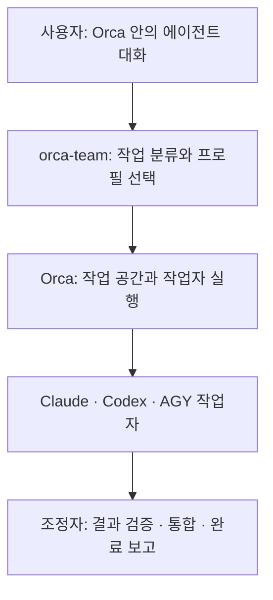

# Orca Orchestration Kit

**Claude·Codex·AGY가 작업에 맞는 모델과 추론 강도로 함께 일하도록 돕는 스킬입니다.**

“기능 구현과 검토를 나눠서 진행하고 싶은데, 매번 도구와 모델을 직접 정하기는 번거롭다”면 이 프로젝트를 사용할 수 있습니다. 평소 쓰는 에이전트에게 `orca-team`을 호출하면, 그 에이전트가 작업을 나누고 Orca로 작업자를 실행해 결과를 확인합니다.

> “orca-team 스킬로 이 기능을 구현하고, 다른 도구로 검토해줘.”

**처음 사용하시나요? → [환경 준비부터 첫 작업까지 따라 하기](docs/GETTING_STARTED.md)**

## Orca는 무엇인가요?

[Orca](https://www.onorca.dev/)는 프로젝트, Git 작업 공간, 터미널과 AI 코딩 에이전트를 한곳에서 관리하는 앱입니다. 여러 에이전트를 실행하고 각 작업의 진행 상태를 확인할 수 있습니다. [공식 설치 안내](https://www.onorca.dev/docs/install)에서 앱을 받을 수 있습니다.

Orca를 설치하는 것과 이 스킬을 설치하는 것은 서로 다른 단계입니다. **Orca가 작업자를 실행할 환경을 제공하고, 이 스킬은 언제 어떤 작업자와 모델을 사용할지 정하는 운영 규칙을 제공합니다.** 에이전트 CLI와 로그인도 별도로 준비합니다.



| 용어 | 쉽게 이해하기 |
|---|---|
| CLI | 터미널에서 실행하는 도구입니다. 앱 설치만으로 CLI까지 준비되었다고 가정하지 않습니다. |
| 조정자 | 처음 대화를 시작한 에이전트입니다. 작업을 나누고 결과를 확인합니다. |
| 작업자 | 조정자가 맡긴 일을 수행하는 추가 에이전트입니다. 최대 2명을 사용합니다. |
| 모델 | 도구 안에서 실제로 응답을 생성하는 AI입니다. |
| effort | 모델의 추론 강도입니다. 같은 high라도 모델마다 비용·성능이 같지는 않습니다. |
| 프로필 | 도구·모델·effort를 묶어 둔 실행 설정입니다. |
| 스킬 | 에이전트가 읽고 따르는 운영 지침입니다. 상시 실행 서버는 아닙니다. |

## 무엇을 준비해야 하나요?

| 준비물 | 필요한 이유 | 안내 |
|---|---|---|
| Git | 이 저장소를 받고 업데이트합니다. | [Git 설치](https://git-scm.com/downloads) |
| Python 3.9+ | 설치·진단·모델 선택 도구를 실행합니다. 추가 패키지는 필요 없습니다. | [Python 다운로드](https://www.python.org/downloads/) |
| Orca 앱과 CLI | 작업 공간과 에이전트를 실행합니다. | [Orca 설치](https://www.onorca.dev/docs/install) |
| 사용할 에이전트 CLI와 로그인 | 실제 작업을 수행합니다. | [Codex](https://learn.chatgpt.com/docs/codex/cli) · [Claude Code](https://code.claude.com/docs/en/quickstart) · [AGY](https://antigravity.google/docs/getting-started?tab=cli) |
| Jev 인증 — 선택 | 애매한 작업 분류를 보조합니다. 첫 시작에는 없어도 됩니다. | [Jev 안내](skills/orca-team/references/jev.md) |

세 에이전트를 모두 준비할 필요는 없습니다. **Codex·Claude·AGY 중 익숙한 도구 하나로 시작**하세요. 기본 네 프로필을 그대로 쓰려면 Codex와 AGY가 필요합니다. Claude만 사용할 때는 해당 도구에서 지원하는 모델을 확인해 로컬 프로필을 추가합니다.

## 이미 환경이 준비됐다면

**일반 터미널**에서 저장소를 받은 뒤, **키트 저장소 디렉토리**에서 실행하세요.

```sh
git clone https://github.com/HashCitrine/orca-orchestration-kit.git
cd orca-orchestration-kit
python3 kit.py install
python3 kit.py setup --agent codex
```

Windows PowerShell에서는 `python3` 대신 `py -3`를 사용합니다. Claude는 `--agent claude`, AGY는 `--agent agy`를 선택하세요.

다음으로 **Orca에서 작업할 프로젝트를 열고 새 에이전트 대화**를 시작합니다. `setup`이 출력한 요청문을 붙여 넣으면 에이전트가 첫 모델 검증을 안내합니다. `setup` 자체는 로그인·권한 변경·작업자 실행을 하지 않습니다.

첫 설치에서 `blocked`가 나오는 것은 검증 기록이 없기 때문일 수 있습니다. 이제 검증 파일을 직접 작성할 필요 없이 `verify-profile`로 실제 성공한 작업의 근거를 등록합니다. [첫 실행 안내](docs/GETTING_STARTED.md#4-첫-모델을-검증하고-작업을-시작하세요)를 따라가세요.

## 모델은 어떻게 선택하나요?

| 작업 | 프로필 | 기본 도구·모델 | effort |
|---|---|---|---|
| 단순 수정·정리 | light | AGY · gemini-3.8-flash-low | low |
| 일반 구현·테스트 | standard | Codex · gpt-6.1-sol | medium |
| 설계·원인 분석·복잡한 작업 | deep | Codex · gpt-6-astra | high |
| 별도 검토 | review | AGY · gemini-4-argon-high | high |

이 표는 초기 균형형 설정이며 성능 순위가 아닙니다. 현재 요청이 로컬 설정과 기본 프로필보다 우선합니다. 지원하지 않는 모델을 자동으로 추측하거나 최신 모델로 바꾸지 않습니다.

- 검증된 조합만 자동 배정합니다. 7일이 지나거나 실행 파일이 바뀌면 다시 확인합니다.
- 품질 실패 시 종료된 작업에 한해 한 번만, high 이하의 지정 상향 프로필로 전환합니다.
- 명시한 모델은 임의 대체하지 않습니다. 로그인·네트워크 문제를 모델 상향으로 해결하지 않습니다.
- 모델 목록·구독 잔여량·최저 비용을 자동 수집·계산하지 않습니다.

[프로필 설정과 상향 규칙 자세히 보기](docs/ROUTING.md)

## 이렇게 요청해보세요

| 목적 | 요청 예시 |
|---|---|
| 구현과 독립 검토 | “orca-team으로 구현하고 다른 도구로 검토해줘.” |
| 복잡한 문제 해결 | “orca-team으로 원인을 분석하고 난이도에 맞춰 모델과 effort를 선택해줘.” |
| 선택 결과 미리 확인 | “이 작업에 사용할 프로필과 선택 이유부터 알려줘.” |

작은 일은 직접 처리합니다. 팀 작업을 명시하지 않으면 자동으로 작업자를 시작하지 않고 필요할 때 추천합니다.

## 업데이트·다른 컴퓨터에서 사용하기

```sh
# 키트 저장소 디렉토리
git pull --ff-only
python3 kit.py update
python3 kit.py setup --agent codex
```

새 대화에서 업데이트된 스킬을 사용하세요. 다른 컴퓨터에서는 저장소를 다시 받아 설치하고 각 도구에 로그인·검증하면 됩니다. 인증정보와 모델 검증 기록은 복사하지 않습니다. Windows 네이티브와 WSL은 별도 환경입니다.

제거는 `python3 kit.py uninstall`입니다. 사용자 수정 파일을 발견하면 중단하며 로그인·로컬 설정은 지우지 않습니다. [설정·업데이트·문제 해결](docs/GETTING_STARTED.md#5-설정과-문제-해결)을 참고하세요.

## 현재 범위와 검증

이 프로젝트는 에이전트 안내형 도구입니다. 작업자 실행·완료 메시지 처리·회수는 조정자가 Orca로 수행합니다. 원격 컴퓨터 작업 분배나 별도 강제 스케줄러는 포함하지 않습니다. 모델 검증은 작은 작업의 실행 확인이지 성능 벤치마크가 아닙니다.

자동 테스트와 실제 환경 검증을 구분하여 [검증 결과](docs/VALIDATION.md)에 기록합니다. OS별 CI 성공이 각 OS에서 모든 에이전트의 로그인과 실행까지 검증했다는 뜻은 아닙니다.

| 문서 | 내용 |
|---|---|
| [처음 시작하기](docs/GETTING_STARTED.md) | 준비·설치·세 도구별 첫 실행·문제 해결 |
| [프로필 운영](docs/ROUTING.md) | 모델 설정, 검증 기록, 상향 규칙 |
| [계획](docs/PLAN.md) / [진행 현황](docs/PROGRESS.md) | 구현 범위와 남은 작업 |
| [검증 기록](docs/VALIDATION.md) | 실제 확인한 환경과 제한 |

## 라이선스

[MIT 라이선스](LICENSE)로 제공합니다. 외부 도구·모델·API는 각 공급자의 이용 조건을 따릅니다. [코드 출처 안내](docs/PROVENANCE.md)도 확인해주세요.
