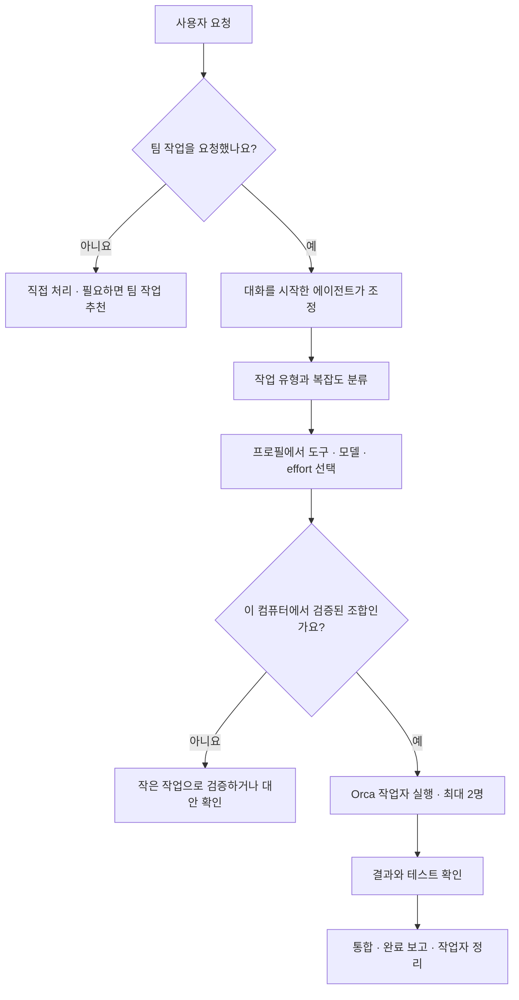
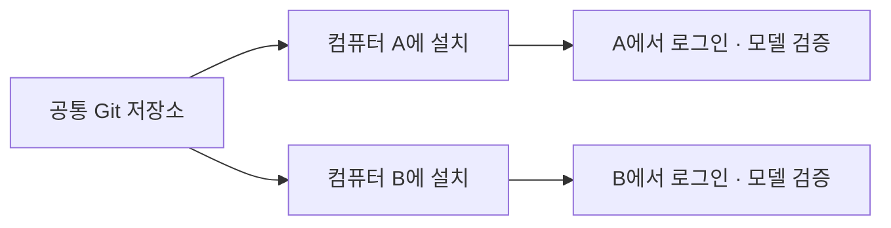

# Orca Orchestration Kit

**Claude, Codex, AGY를 작업에 맞는 모델과 추론 강도로 함께 활용하는 개인용 설정 모음입니다.**

평소 사용하는 에이전트에게 작업을 요청하세요. `orca-team` 스킬을 호출하면 그 에이전트가 조정자가 되어 작업을 나누고, 필요한 작업자를 Orca로 실행한 뒤 결과를 확인하고 정리합니다.

> “orca-team 스킬로 이 기능을 구현해줘. 구현과 검토는 나눠서 진행해줘.”

작은 작업은 직접 처리하고, 병렬 작업이나 별도 검토가 도움이 될 때 팀으로 진행합니다. 매번 세 도구를 모두 실행할 필요는 없습니다.

[빠른 시작](#빠른-시작) · [사용 예시](#이렇게-요청해보세요) · [모델 선택](#모델과-effort는-어떻게-선택하나요) · [다른 컴퓨터에서 사용](#다른-컴퓨터에서도-사용하려면) · [문제 해결](#문제가-생겼을-때)

## 어떻게 동작하나요?



| 구성 요소 | 하는 일 |
|---|---|
| **조정자** | 작업을 나누고, 프로필을 선택하고, 결과를 검증합니다. 처음 대화를 시작한 Claude·Codex·AGY가 맡습니다. |
| **Orca** | 작업 공간과 작업자를 실행하고, 질문·응답·완료 상태를 관리합니다. |
| **작업자** | 정해진 범위의 구현·조사·검토를 수행합니다. 조정자 외 최대 2명까지 사용합니다. |
| **이 프로젝트** | 공통 스킬, 모델 선택 규칙, 설치·진단 도구를 제공합니다. |
| **Jev — 선택 사항** | 작업 유형이나 복잡도가 애매할 때 판단을 보조합니다. |

이 프로젝트는 별도로 상시 실행하는 서버가 아닙니다. 에이전트가 읽는 **운영 스킬**과, 모델 선택 등을 일관되게 처리하는 **Python 도구**로 구성됩니다. 작업 수명 관리와 실제 실행은 Orca가 담당합니다.

## 빠른 시작

### 1. 사용할 도구를 준비하세요

- **Python 3.9 이상** — 별도 Python 패키지 설치는 필요하지 않습니다.
- **Orca** — 설치하고 실행해두세요.
- **Claude Code, Codex CLI, AGY CLI 중 사용할 도구** — 각 컴퓨터에서 설치와 로그인을 마쳐주세요.

모든 도구를 반드시 설치할 필요는 없습니다. 다만 아래 기본 모델 프로필을 그대로 사용하려면 Codex와 AGY가 필요합니다. Claude도 조정자와 작업자로 사용할 수 있으며, 전용 모델 프로필은 별도로 추가할 수 있습니다.

### 2. 저장소를 받아 스킬을 설치하세요

**macOS / Linux / WSL**

```sh
git clone https://github.com/HashCitrine/orca-orchestration-kit.git
cd orca-orchestration-kit
python3 kit.py install
python3 kit.py doctor
```

**Windows — PowerShell**

```powershell
git clone https://github.com/HashCitrine/orca-orchestration-kit.git
cd orca-orchestration-kit
py -3 kit.py install
py -3 kit.py doctor
```

`install`은 각 도구의 개인 스킬 경로에 파일을 복사합니다. 기존 사용자 설정이나 로그인 정보는 변경하지 않습니다. `doctor`는 실행 파일과 기본 준비 상태를 확인합니다. 로그인 성공이나 모든 모델의 사용 가능 여부까지 보장하는 검사는 아닙니다.

### 3. 새 대화에서 모델 검증을 요청하세요

Orca에 작업할 프로젝트를 등록하고, 사용할 에이전트의 **새 대화**를 시작하세요. 첫 설치라면 다음처럼 요청할 수 있습니다.

> “orca-team 스킬을 읽고, 이 컴퓨터에서 사용할 기본 모델 프로필을 작은 읽기 전용 작업으로 검증해줘. 성공한 조합의 검증 근거를 로컬에 등록해줘.”

**새 컴퓨터에서는 모델 검증 기록이 없으므로 처음에 `blocked`가 나올 수 있습니다.** 설치 실패라는 뜻은 아닙니다. 조정자가 실제 실행과 완료 보고를 확인한 조합만 자동 배정하도록 한 동작입니다. 현재는 검증을 한 번에 수행하는 별도 CLI 명령이 없으며, 조정자가 [프로필 운영 안내](docs/ROUTING.md)에 따라 검증·등록합니다.

기존 대화는 설치 전의 스킬 내용을 유지할 수 있으므로, 설치·업데이트 후에는 새 대화를 권장합니다.

## 이렇게 요청해보세요

| 하고 싶은 일 | 요청 예시 |
|---|---|
| 기능 구현과 별도 검토 | “orca-team으로 이 기능을 구현하고, 다른 도구로 검토해줘.” |
| 복잡한 문제 분석 | “orca-team으로 이 오류의 원인을 분석해줘. 복잡도에 맞춰 모델과 effort도 선택해줘.” |
| 단순 작업 묶음 | “orca-team으로 이 문서들을 정리해줘. 독립적인 작업만 나눠서 진행해줘.” |
| 모델을 직접 지정 | “이번 구현은 Codex의 gpt-6.1-sol, effort medium으로 진행해줘.” |
| 현재 선택 확인 | “이 작업에 어떤 프로필을 쓸지와 선택 이유부터 알려줘.” |

팀 작업을 명시하지 않으면 작업자를 자동으로 시작하지 않습니다. 효율이 높아질 것으로 판단되면 먼저 활용을 추천합니다.

## 모델과 effort는 어떻게 선택하나요?

**작업 유형 → 프로필 → 도구·모델·effort** 순서로 선택합니다. 여기서 *effort*는 모델이 추론에 들이는 강도입니다. 서로 다른 모델에서 같은 `high`라고 해도 비용이나 성능이 같다는 뜻은 아닙니다.

| 작업 | 프로필 | 기본 도구 | 기본 모델 | effort |
|---|---|---|---|---|
| 단순 수정·정리 | `light` | AGY | `gemini-3.8-flash-low` | low |
| 일반 구현·테스트 | `standard` | Codex | `gpt-6.1-sol` | medium |
| 설계·원인 분석 또는 복잡한 작업 | `deep` | Codex | `gpt-6-astra` | high |
| 별도 검토 | `review` | AGY | `gemini-4-argon-high` | high |

이는 **초기 균형형 설정**이며 성능 벤치마크 순위는 아닙니다. 현재 기본 프로필에는 Claude 모델이 포함되어 있지 않습니다. 프로필을 바꾸면 Claude도 모델·effort를 지정해 배정할 수 있습니다.

- AGY 기본 프로필은 모델 ID에 강도가 포함되어 있어 별도의 `--effort`를 중복 전달하지 않습니다.
- 검증된 조합만 자동 선택합니다. 검증 후 **7일이 지나거나 실행 파일이 바뀌면** 다시 확인합니다.
- 품질 문제로 실패한 작업은 기존 작업자가 종료된 것을 확인한 뒤 **최대 한 번, high 이하**의 상향 프로필로 전환합니다. 상향 경로가 없는 프로필은 자동 상향하지 않습니다.
- 인증·설치·네트워크 오류에는 모델 상향을 적용하지 않습니다.
- 명시적으로 지정한 모델을 사용할 수 없으면 임의로 다른 모델로 바꾸지 않습니다.
- 새 모델을 자동으로 채택하거나 도구를 자동 업데이트하지 않습니다. 사용 가능한 모델 목록도 자동 수집하지 않습니다.

사용량이나 구독 잔여량을 조회해 최저 비용 모델을 고르는 기능은 없습니다. 실제 사용 가능 범위는 각 도구의 로그인 계정과 공급자 정책에 따릅니다.

### 실행하지 않고 선택 결과만 확인하기

```sh
python3 kit.py route --task-type implementation
python3 kit.py route --task-type design --complexity complex
python3 kit.py route --task-type review --implementation-agent codex
```

| 결과 | 의미 |
|---|---|
| `ready` | 검증된 조합을 선택했습니다. 조정자가 반환된 `launch_args`로 작업자를 시작할 수 있습니다. |
| `blocked` | 사용 가능한 검증 프로필이 없거나 상향 조건을 만족하지 않습니다. `reason`과 `rejected`를 확인하세요. |

`route` 자체는 작업자를 실행하지 않습니다. 요청한 모델과 실제 런타임 모델은 별도로 확인하며, 확인되지 않은 정보는 미확인으로 기록합니다.

## 내 환경에 맞게 설정하기

설정 파일은 `~/.config/orca-orchestration-kit/config.json`입니다. 저장소의 [`config.example.json`](config.example.json)을 이 위치에 복사하고 필요한 항목만 바꾸세요. **기존 파일이 있다면 덮어쓰지 말고 필요한 항목을 합쳐주세요.**

| 설정 | 용도 |
|---|---|
| `max_workers` | 추가 작업자 수를 `1` 또는 `2`로 제한합니다. |
| `profiles` | 프로필별 도구·모델·effort와 대체·상향 경로를 정의합니다. |
| `routes` | 작업 유형을 원하는 프로필에 연결합니다. |
| `executables` | CLI가 자동으로 발견되지 않을 때 실행 파일 경로를 지정합니다. |
| `skill_roots` | 각 도구의 개인 스킬 설치 경로를 바꿉니다. |
| `models`, `efforts` | 프로필 라우팅을 사용하지 않는 기존 실행 방식의 재정의입니다. |

모델 선택은 **현재 요청 → 컴퓨터별 프로필 → 공통 프로필** 순으로 우선합니다. `profiles`에서 기존 프로필을 수정할 때는 일부 항목만이 아니라 해당 프로필 전체를 작성합니다.

<details>
<summary>예시: 작업자는 한 명만 사용하고 일반 구현은 지정한 Codex 모델로 실행하기</summary>

```json
{
  "max_workers": 1,
  "profiles": {
    "standard": {
      "agent": "codex",
      "model": "gpt-6.1-sol",
      "effort": "medium",
      "effort_mode": "flag",
      "upgrade": "deep"
    }
  },
  "routes": {
    "implementation": "standard"
  }
}
```

설정을 저장해도 새 조합이 즉시 검증 완료로 바뀌지는 않습니다. 모델·effort를 바꿨다면 작은 작업으로 확인한 후 사용하세요. 세부 옵션과 검증 기록 형식은 [프로필 운영 안내](docs/ROUTING.md)를 참고하세요.

</details>

## 다른 컴퓨터에서도 사용하려면



공통 설정은 이 저장소로 옮기고, 각 컴퓨터에서 `install`과 `doctor`를 실행하면 됩니다. Windows 네이티브와 WSL은 서로 다른 환경으로 취급하고 각 환경의 Python·Orca·인증을 사용하세요.

| 함께 가져갈 것 | 각 컴퓨터에서 준비할 것 |
|---|---|
| 저장소의 스킬·도구·기본 프로필·문서 | 도구 설치, 로그인, 로컬 설정, 모델 검증 기록 |

인증정보, API 키, 세션, 로컬 설정, 모델 검증 기록은 동기화하지 않습니다. 이 기능은 **같은 설정을 여러 컴퓨터에서 재사용**하는 것으로, 한 컴퓨터에서 다른 컴퓨터의 작업자를 원격 실행하는 기능은 포함하지 않습니다.

## 업데이트와 제거

저장소 디렉토리에서 실행하세요. Windows에서는 `python3` 대신 `py -3`를 사용합니다.

```sh
# 저장소와 설치된 스킬을 함께 갱신합니다.
git pull --ff-only
python3 kit.py update
python3 kit.py doctor
```

```sh
# 이 도구가 설치한 스킬 파일을 제거합니다.
python3 kit.py uninstall
```

업데이트·제거 시 사용자가 수정한 파일을 발견하면 덮어쓰거나 삭제하지 않고 중단합니다. 변경분을 따로 보관하고 비교한 뒤 다시 실행하세요. 사용자 추가 파일은 보존하며, 로그인 정보·로컬 설정·모델 검증 기록은 제거하지 않습니다.

## Jev는 언제 사용하나요?

Jev는 선택 사항입니다. 작업 유형이나 복잡도가 애매할 때 조정자의 판단을 보조합니다. 모델 순위나 지원 여부, 실행 권한을 결정하지 않습니다.

- 호출 전에 목적과 전송할 발췌를 한국어로 알려줍니다.
- 필요한 내용만 공식 TypeSafe API에 보내며 비밀정보와 개인정보는 제외합니다.
- 인증이나 API 연결에 문제가 있으면 원문과 일반 도구로 계속 진행합니다.

POSIX 환경에서는 다음 명령으로 키를 숨김 입력할 수 있습니다.

```sh
python3 skills/orca-team/scripts/jev.py configure
python3 skills/orca-team/scripts/jev.py status
```

Windows에서는 사용자 환경에 `TYPESAFE_API_KEY`를 설정합니다. 키를 채팅이나 저장소에 넣지 마세요. Jev 인증은 에이전트 CLI 로그인과 별개입니다.

## 문제가 생겼을 때

| 증상 | 먼저 확인할 내용 |
|---|---|
| 스킬이 보이지 않아요 | `install`을 실행했는지, 새 대화를 시작했는지, `skill_roots`가 실제 설치 경로와 맞는지 확인하세요. |
| `route`가 `blocked`를 반환해요 | 첫 설치이거나 검증 기록이 만료되었을 수 있습니다. 조정자에게 해당 프로필의 작은 실행 검증을 요청하세요. |
| 모델 업데이트 후 선택이 막혀요 | 새 모델의 지원 여부와 effort를 확인하고 프로필을 수정한 뒤 재검증하세요. |
| `doctor`는 성공했는데 실행이 안 돼요 | 로그인·모델 가용성·권한 확인은 별개입니다. 실제 실행 오류와 Orca 작업자 상태를 확인하세요. |
| 업데이트 시 파일 충돌이 나요 | 설치본의 사용자 수정이 보호된 상태입니다. 변경분을 보관·비교한 뒤 다시 실행하세요. |
| 작업자가 응답하지 않아요 | 종료 여부를 확인하기 전에는 같은 작업자를 다시 띄우지 마세요. 조정자에게 Orca 상태 확인을 요청하세요. |

<details>
<summary>Claude가 권한 모드 확인 화면에서 멈추는 경우</summary>

Orca에 설정된 Claude 실행 인자가 권한 우회 모드를 사용하면, 최초 확인 화면 때문에 작업자 준비가 멈출 수 있습니다. `doctor`의 `claude_worker`를 확인하세요.

| 상태 | 의미 |
|---|---|
| `ready` | 확인한 설정상 이 준비 단계의 차단 요인이 없습니다. 실제 작업 성공을 보장하지는 않습니다. |
| `needs_claude_setup` | 권한 우회 모드의 최초 확인 설정이 필요합니다. 원하는 권한 정책부터 결정하세요. |
| `unknown` | 설정을 확인하지 못했습니다. 작은 작업으로 실제 상태를 확인하세요. |

**권한 우회 모드를 사용하기로 결정한 경우에만** 다음 명령을 실행하세요.

```sh
python3 kit.py claude-setup
```

이 명령은 기존 Claude 설정을 백업한 뒤 `skipDangerousModePermissionPrompt: true`를 추가합니다. 다른 설정은 보존합니다. `install`, `update`, `uninstall`은 이 설정을 변경하지 않습니다.

권한 우회를 원하지 않으면 Orca에서 Claude 실행 설정을 원하는 권한 모드로 변경하세요. 이 프로젝트는 Orca 앱의 권한 설정을 자동으로 바꾸지 않습니다. 되돌릴 때는 추가한 키만 제거하거나, 이후 설정 변경을 확인한 뒤 백업을 복원하세요.

</details>

## 검증 상태와 자세한 문서

현재 자동 테스트 **12개**와 macOS의 **네 기본 모델 프로필 실제 실행·완료 보고·회수**를 확인했습니다. Claude 작업자와 조정자 검증도 기록되어 있습니다. 이는 작은 작업의 동작 확인이며, 모델 간 성능 비교 결과는 아닙니다.

Linux·Windows·WSL의 실제 사용자 환경 실행, AGY 조정자 역할, Jev 실제 API 평가는 아직 미검증입니다. OS별 테스트 매트릭스를 제공하지만 실제 실행 결과와 구분합니다. 동시 작업자 수와 종료 확인 등의 운영 규칙은 에이전트가 따르는 스킬이며, 별도 서버가 강제하는 스케줄러는 아닙니다.

```sh
python3 -m unittest discover -s tests -v
```

| 문서 | 내용 |
|---|---|
| [작업 계획](docs/PLAN.md) | 목표와 구현 범위 |
| [진행 현황](docs/PROGRESS.md) | 완료 항목과 남은 작업 |
| [검증 결과](docs/VALIDATION.md) | 실제 확인한 환경과 제한 |
| [모델 프로필 운영](docs/ROUTING.md) | 선택 우선순위, 검증 기록, 대체·상향 규칙 |
| [공통 스킬](skills/orca-team/SKILL.md) | 에이전트가 따르는 운영 지침 |

## 라이선스와 출처

이 프로젝트는 [MIT 라이선스](LICENSE)로 제공합니다. 출처와 라이선스 고지를 유지하면서 사용·수정·배포할 수 있습니다. 외부 CLI·모델·API는 각 공급자의 이용 조건을 따릅니다. [코드 출처 안내](docs/PROVENANCE.md)도 함께 확인해주세요.
